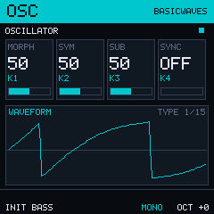
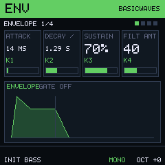
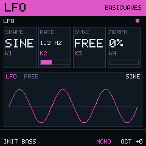
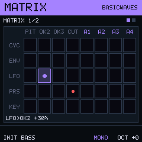
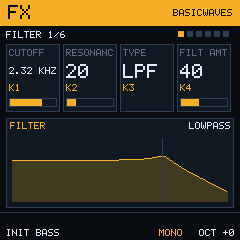
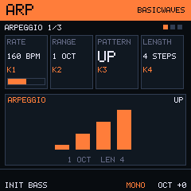
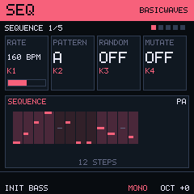
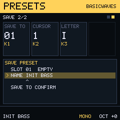

# Nano Freak for the M-Vave FM-1

**Nano Freak** is a work in progress: a Freak Synthesizer for the M-Vave FM-1 (and SMK-37). The sound engine is being ported to the
FM-1's integer-only firmware from the [Nano Freak browser test bed](https://github.com/Virusiinstaller/nano-freak), one oscillator type at a time.
It is built on the FMini-1 firmware by Guilherme Ruppert, itself a fork of Felucca by Leo Kuroshita (all GPL-3.0-only). Their work is
credited below and in [CREDITS.md](CREDITS.md).

**Not tested on a real FM-1.**

  

## 1. Where it stands

| Part | State |
| --- | --- |
| Oscillators | NANO engine: **Basic Waves**, **Two Op FM** and **Waveshaper** work; Formant, Chords, Modal, Noise and the rest are next |
| Filter, envelopes, LFO, matrix | stand-in filter for now; the Nano Freak ones are next |
| Effects, arpeggiator, sequencer | in the test bed; not yet ported |
| Screens and knobs | the firmware still has the FMini-1 screens; the Nano Freak screens come with the app layer |

The NANO engine can be chosen on the device with the *engine preview* package (the full Felucca interface). The product firmware does not
select it yet.

## 2. The test bed screens

These are the screens the firmware is being built to match.

  
  
  
  

  
  
  
  

## 3. Installation

Site and web installer: <https://virusiinstaller.github.io/nano-freak-fm1/>

Supports the new FM-1 versions (with the UC25HQ80 flash chip). **M-Vave SMK-37 (beta):** see [SMK-37 instructions](SMK37.md).

## 4. Credits

- **FMini-1** (the firmware this is built on) was made by Guilherme Ruppert, <https://github.com/ruppert/fmini-1>.
- FMini-1 is inspired and partially based on the [Felucca](https://github.com/hugelton/Felucca) project by Leo Kuroshita (Hügelton Instruments).
- The oscillator types are ports of ideas and tables from Mutable Instruments Plaits by Emilie Gillet (MIT), through the Nano Freak test bed.
- Everything else is credited in [CREDITS.md](CREDITS.md).

**AI disclaimer:** this project was developed with the assistance of [Claude](https://claude.ai), an AI model by Anthropic.

Based on <a href="https://github.com/hugelton/Felucca">Felucca</a> by Leo Kuroshita · <a href="LICENSE">GPL-3.0-only</a>

