# Nano Freak for the M-Vave FM-1

**Nano Freak** is a uFreak Synthesizer for the M-Vave FM-1 (and SMK-37, beta). Its sound engine and screens were first made in the
[Nano Freak browser test bed](https://github.com/Virusiinstaller/nano-freak) and now run as integer-only firmware on the FM-1's
chip. It is built on the FMini-1 firmware by Guilherme Ruppert, itself a fork of Felucca by Leo Kuroshita (all GPL-3.0-only). Their
work is credited below and in [CREDITS.md](CREDITS.md).

**Version 3.0.0: tested on a real FM-1.** The SMK-37 builds are beta and have not been tested on an SMK-37. This is custom firmware: use it at your own risk.

  

## 1. What is in the firmware

| Part | What it has |
| --- | --- |
| Oscillators | Fifteen types, each with four knobs and a picture of the sound; Strings has a second page |
| Filter | State-variable or Minimoog-style ladder, with slope, drive and clip |
| Envelopes and LFOs | Envelope, cycling envelope (loops like an LFO) and amplitude mode; **two LFOs**, each with its own four assignable destinations |
| Modulation matrix | Five sources (cycling envelope, envelope, LFO 1, LFO 2, key) against eight destinations, an amount at every point, four assignable columns |
| Effects | Reverb, delay, a Haas **stereo widener** (WIDTH, TIME 1 to 50 ms, SIDE, TONE), glide and pitch bend |
| Impress and Chance | Variation for the arpeggiator and sequencer: IMP STR and CH STR set how strong, CH AMT and IMP AMT how much of it plays. The two right-most keys always bend the pitch |
| Arpeggiator and sequencer | Patterns, latch, swing, chord mode; a 64-step sequencer with Random and Mutate |
| Presets | 58 factory presets, user slots, a browser and a Save page with names |
| MIDI | USB MIDI with about 70 CC numbers, clock, routing and thru |

The SMK-37 builds are beta and have not been tested on an SMK-37. Every page, knob and range is listed in the **Reference** section of the [site](https://virusiinstaller.github.io/nano-freak-fm1/#ref).

## 2. The screens

These are drawn by the firmware's own painter.

  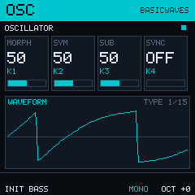
  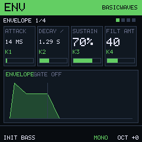
  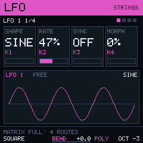
  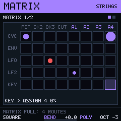

  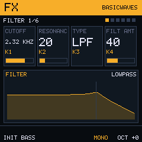
  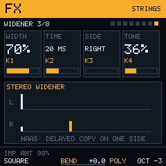
  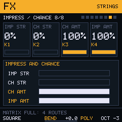
  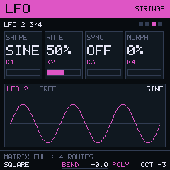

  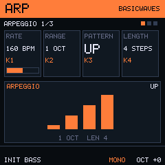
  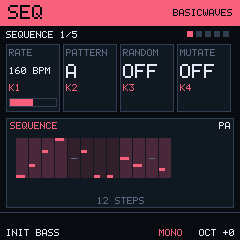
  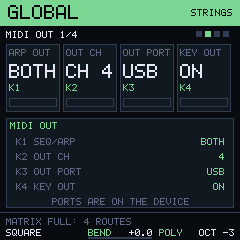
  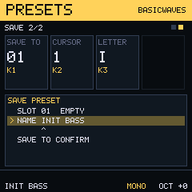

## 3. Installation

Site and web installer: <https://virusiinstaller.github.io/nano-freak-fm1/>

Supports the new FM-1 versions (with the UC25HQ80 flash chip). **M-Vave SMK-37 (beta):** see [SMK-37 instructions](SMK37.md).

## 4. Credits

- **FMini-1** (the firmware this is built on) was made by Guilherme Ruppert, <https://github.com/ruppert/fmini-1>.
- FMini-1 is inspired and partially based on the [Felucca](https://github.com/hugelton/Felucca) project by Leo Kuroshita (Hügelton Instruments).
- The oscillator types are ports of ideas and tables from Mutable Instruments Plaits by Emilie Gillet (MIT), through the Nano Freak test bed.
- Everything else is credited in [CREDITS.md](CREDITS.md).

**AI disclaimer:** this project was developed with the assistance of [Claude](https://claude.ai), an AI model by Anthropic.

Based on <a href="https://github.com/hugelton/Felucca">Felucca</a> by Leo Kuroshita · <a href="LICENSE">GPL-3.0-only</a>

